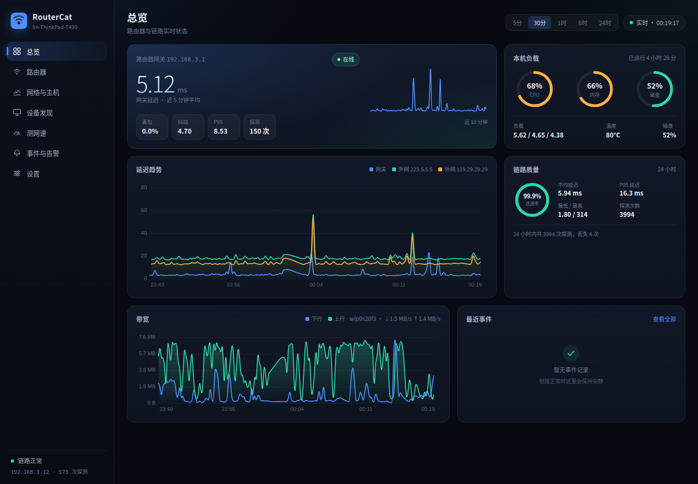
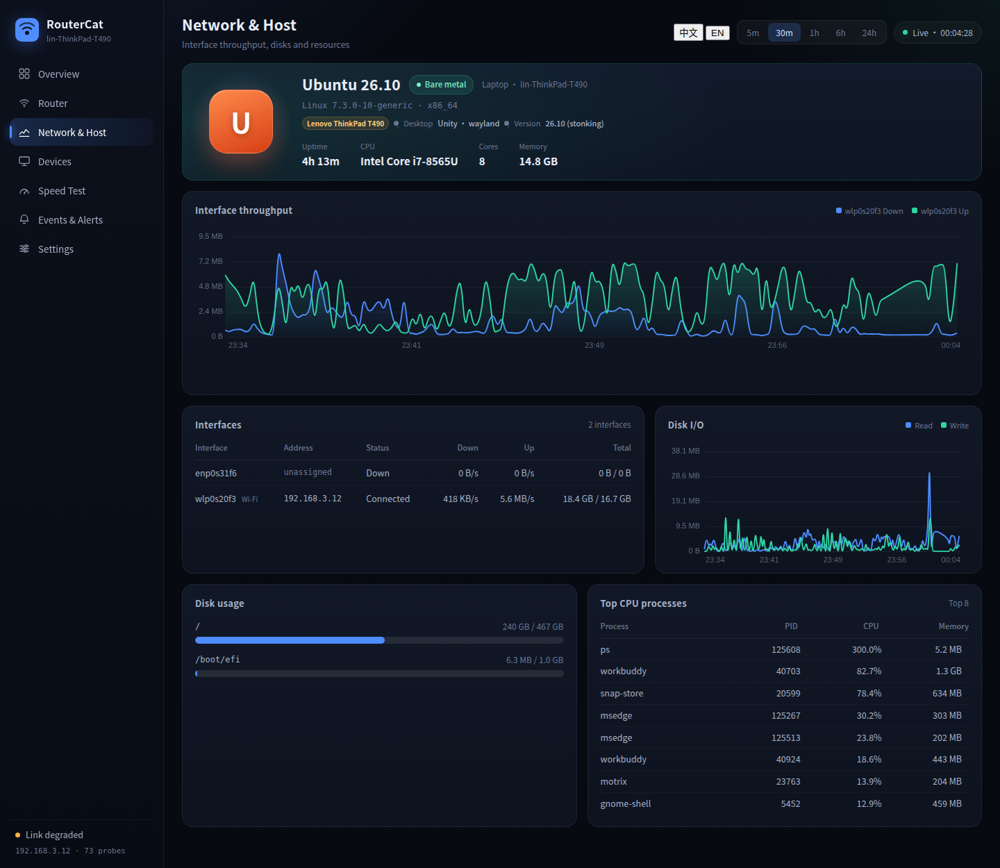
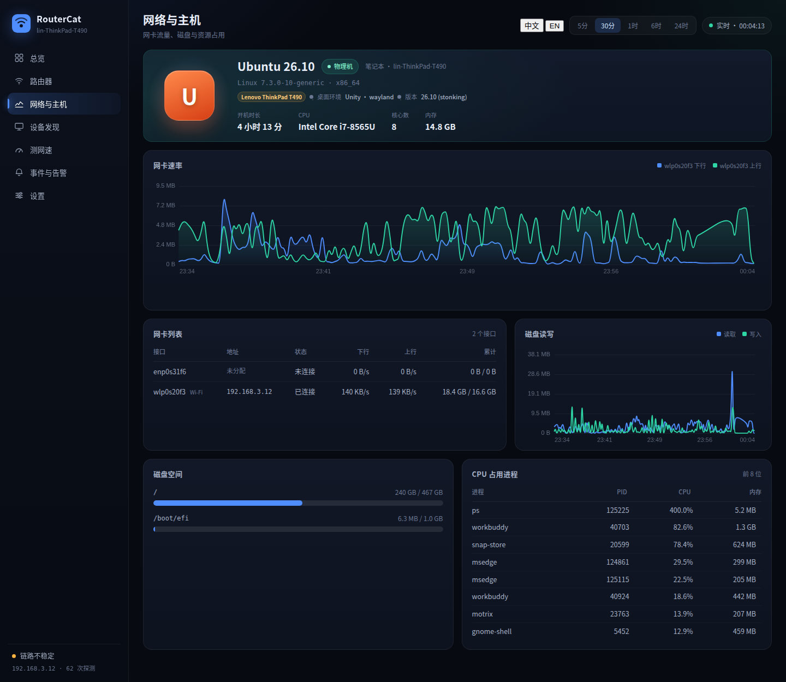
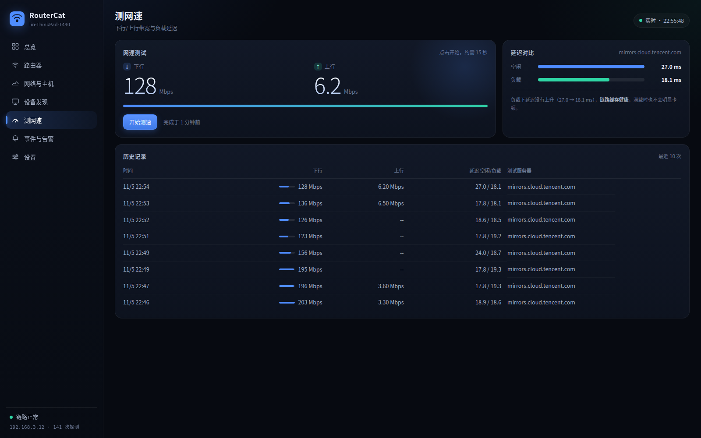

# RouterCat · Ubuntu 路由器状态监控

一个参考 ServerCat 交互形态、为 Ubuntu 打造的**路由器 / 链路状态监控面板**。
纯 Python 标准库 + 原生前端，没有第三方依赖，装好 Ubuntu 解压即用，浏览器打开就能看。



## 它监控什么

| 维度 | 指标 |
| --- | --- |
| 路由器 | 网关延迟、丢包率、抖动、P95、在线状态、网关 MAC / 出口网卡 |
| 路由器型号 | 自动识别品牌 / 型号 / 硬件版本 / 序列号 / 运行时长（华为、小米、TP-Link、华硕、OpenWrt 等） |
| 外网链路 | 多个外网目标的 ICMP 延迟与丢包、DNS 解析耗时、TCP 握手、HTTP 状态 |
| 本机网络 | 每块网卡的实时上下行速率、累计流量、错误与丢包计数 |
| 本机系统 | 自动识别发行版 / 版本、内核、架构、桌面环境、整机型号、物理机还是虚拟机/容器 |
| 本机资源 | CPU 总体与逐核占用、内存 / Swap、负载、温度、磁盘空间、磁盘读写 IO、CPU 占用进程 |
| 局域网 | 从 ARP 邻居表发现终端设备，可按需扫描整个网段 |
| 网速测试 | 下行/上行带宽实测，以及测速期间的“空闲 vs 负载”延迟（bufferbloat） |
| 告警 | 网关不可达、链路丢包、延迟/抖动超标、外网中断、CPU/内存/磁盘过高、网卡断开 |

所有样本写入本地 SQLite（默认保留 7 天），图表可按 5 分钟 / 30 分钟 / 1 小时 / 6 小时 / 24 小时回看。

## 快速开始

```bash
# 需要 python3（Ubuntu 自带）
cd routercat
./run.sh                    # 默认 0.0.0.0:8848

# 或者指定端口
./run.sh --port 9000
```

浏览器打开 `http://127.0.0.1:8848`，同一局域网内可用 `http://<本机IP>:8848` 在手机上看。

启动后会自动探测默认网关，无需任何配置。

### 开机自启（systemd）

```bash
./install.sh          # 默认 8848 端口，安装并立即启动
./install.sh 9000     # 自定义端口
```

安装脚本会写入 `/etc/systemd/system/routercat.service`，日志用 `journalctl -u routercat -f` 查看。

## 界面

| 页面 | 内容 |
| --- | --- |
| 总览 | 路由器状态大卡、本机三环负载、延迟趋势、链路质量、带宽、最近事件 |
| 路由器 | 网关信息、连通性探测表、网关/外网延迟曲线、丢包率对比 |
| 网络与主机 | 本机系统卡（发行版 / 机型 / 虚拟化）、网卡速率曲线、网卡列表、磁盘读写、磁盘空间、CPU 占用进程 |
| 设备发现 | ARP 邻居设备列表，一键扫描网段 |
| 测网速 | 一键测下载/上传带宽，并给出空闲与负载延迟对比 |
| 事件与告警 | 进行中 / 已恢复事件，按级别筛选 |
| 设置 | 界面语言、探测间隔与目标、告警阈值、数据保留、CSV 导出 |

支持窄屏自动切换为顶部导航，手机上也能看。

### 中英文切换

在**设置 → 界面语言**里选「自动 / 中文 / English」，右上角没有常驻开关，其他页面保持干净。选择记在浏览器 localStorage，同时会写进服务端配置 `app.lang` 作为新访客的默认值：

```bash
http://127.0.0.1:8848/?lang=en    # 用链接强制英文，适合分享或值守大屏
```

界面文案、图表图例、告警标题与描述都会跟着切换——历史事件也能切换语言：后端只存 `code` + `params`（例如 `loss=12.4`），句子在前端拼，所以三个小时前的告警切到英文也能正确重排。







## 配置

配置保存在 `data/config.json`，也可以在“设置”页面里改，保存即生效。

```jsonc
{
  "app":   { "listen_host": "0.0.0.0", "listen_port": 8848,
             "lang": "auto" },              // auto = 跟随浏览器；zh / en = 固定语言
  "router":{ "gateway": "auto",            // auto = 跟随默认路由，或写死 IP
             "name": "",                   // 留空 = 用自动识别到的型号，填了以你写的为准
             "image": "/img/router.png",   // 面板上的设备图，换成自己的图放 static/img/ 下即可
             "auto_detect": true,          // 自动识别型号（MAC 厂商 / 厂商接口 / UPnP / 登录页）
             "detect_ttl": 21600,          // 识别结果缓存 6 小时
             "detect_timeout": 4,          // 单层探测超时（秒）
             "oui_online": true },         // 本地 MAC 厂商库查不到时，联网补查一次
  "probe": {
    "gateway_interval": 2,                  // 网关探测间隔（秒）
    "wan_interval": 5,                      // 外网探测间隔
    "wan_targets": ["223.5.5.5", "119.29.29.29"],
    "dns_interval": 30,
    "dns_targets": ["www.baidu.com"],
    "tcp_interval": 15,
    "tcp_targets": [{ "host": "223.5.5.5", "port": 53, "label": "阿里 DNS :53" }],
    "http_interval": 60,
    "http_targets": [{ "url": "https://www.baidu.com", "label": "百度首页" }]
  },
  "sample":    { "interval": 2 },           // 系统采样间隔
  "retention": { "days": 7 },               // 样本保留天数
  "speedtest": {
    "duration": 8,                          // 测速时长（秒）
    "upload_size_mb": 10,                   // 上行测试要发的数据量
    "download_urls": [                      // 会先各试 1.3 秒，挑最快的
      "https://mirrors.aliyun.com/ubuntu/ls-lR.gz",
      "https://mirrors.cloud.tencent.com/ubuntu/ls-lR.gz",
      "https://mirrors.tuna.tsinghua.edu.cn/ubuntu/ls-lR.gz"
    ],
    "upload_urls": ["https://httpbin.org/post"],  // 需接受匿名 POST，留空则不测上行
    "latency_target": ""                    // 负载延迟采样目标，留空用第一个外网目标
  },
  "thresholds": {
    "loss_pct": 5, "latency_ms": 80, "jitter_ms": 40,
    "cpu_pct": 90, "mem_pct": 92, "disk_pct": 90
  }
}
```

### 网速测试怎么测的

1. **选服务器**：对 `download_urls` 里的地址各拉 1.3 秒数据，取后 60% 的斜率当稳态带宽（避免 TCP 慢启动把千兆宽带测成几兆），挑最快的那个。
2. **下测**：在 `duration` 秒内持续下载，文件读完会自动重连续测，最终取“去掉首秒”的稳态速率。
3. **上测**：向 `upload_urls` 中的地址 POST 随机数据。先探活挑一个能用的地址并记住，下次直接用；全都不可达时自动跳过，不会卡住。
4. **负载延迟**：下载过程中每 0.5 秒 ping 一次外网目标，和测速前的空闲延迟对比。差值大说明路由器有缓冲膨胀（bufferbloat），满载下载时视频会议会卡。

### 型号是怎么自动识别的

四层探测并行跑，哪层先给出结果就算哪层的，全程 2 秒左右，失败也不影响监控：

| 层 | 手段 | 拿到什么 |
| --- | --- | --- |
| 1 | 网关 MAC 前三字节查 OUI 库 | 厂商（华为 / 小米 / TP-Link……）。优先读系统 IEEE 库 `/usr/share/ieee-data/oui.csv`，没装就退回内置的 210 条常见路由厂商表 |
| 2 | 厂商免鉴权接口 | 精确型号。华为 `/api/system/deviceinfo` 直接给中文型号、产品代号、硬件版本、序列号、运行时长；小米 `/cgi-bin/luci/api/xqsystem/init_info` 给 `R4A` 这类代号 |
| 3 | UPnP / SSDP 的 `modelName` | 大部分消费级路由（华硕、网件、TP-Link、OpenWrt）开着 UPnP 时最准；华为默认关闭 |
| 4 | 登录页 title / 关键字 | 兜底：认品牌，再从标题里抠带数字的型号串 |

结果缓存在 `data/router_identity.json`，默认 6 小时（`router.detect_ttl`）重认一次；网关地址或 MAC 变了会立刻重认。卡片右上角的「自动识别」按钮可以随时手动重跑，鼠标悬停能看到这次用了哪些来源、置信度和耗时。

> 装一下 `sudo apt install ieee-data` 可以让 MAC 厂商库从 210 条扩到 3.9 万条，识别率更高（不装也能用）。

### 本机系统是怎么识别的

进程启动时读一轮系统文件，结果整个生命周期不变，不耗时也不占资源：

| 项目 | 来源 |
| --- | --- |
| 发行版 / 版本 / 代号 | `/etc/os-release`（`PRETTY_NAME`、`VERSION_ID`、`VERSION_CODENAME`） |
| 内核 / 架构 | `uname`（`platform.uname()`） |
| 桌面环境 / 会话类型 | `XDG_CURRENT_DESKTOP`、`DESKTOP_SESSION`、`XDG_SESSION_TYPE`，归一到 GNOME / KDE Plasma / Unity… |
| 整机型号 | DMI：`/sys/class/dmi/id/{sys_vendor,product_name,product_version,board_name,chassis_type}`；`product_version` 更像商品名时优先用它（ThinkPad 的 `product_name` 是内部料号 `20N2A00TCD`） |
| 物理机 / 虚拟机 / 容器 | `/.dockerenv`、`/run/.containerenv`、`/proc/1/cgroup`、`/proc/vz`，最后用 `systemd-detect-virt --vm` 兜底 |
| CPU / 核心数 / 内存 | `/proc/cpuinfo`、`os.cpu_count()`、`/proc/meminfo` |

识别结果放在 `/api/overview` 的 `host.system` 里，读不到就留空，不影响监控本身。

### 告警触发逻辑

每条规则需要**连续命中**若干次才触发（避免瞬时抖动误报），恢复后事件自动标记为“已恢复”：

| 规则 | 条件 | 连续次数 |
| --- | --- | --- |
| 路由器不可达 | 网关 5 分钟丢包 ≥ 99.9% | 2 |
| 链路丢包 | 5 分钟丢包率 > 阈值 且 < 99.9% | 3 |
| 局域网延迟偏高 | 5 分钟平均延迟 > 阈值 | 3 |
| 网络抖动明显 | 5 分钟抖动 > 阈值 | 3 |
| 外网连接中断 | 所有外网目标 5 分钟全部无响应 | 2 |
| CPU / 内存过高 | 使用率 > 阈值 | 5 |
| 磁盘空间不足 | 任一挂载点使用率 > 阈值 | 2 |
| 网卡断开 | 所有物理网卡 down | 3 |

## HTTP API

| 方法 | 路径 | 说明 |
| --- | --- | --- |
| GET | `/api/overview` | 一次性返回状态、统计、告警、事件、系统快照 |
| GET | `/api/series?metric=ping\|sys\|net\|disk&range=30m&target=gateway` | 时序数据 |
| GET | `/api/devices` | 设备列表 |
| POST | `/api/devices/scan` | 扫描本机所在网段 |
| GET | `/api/events?limit=100` | 事件记录 |
| GET | `/api/speedtest` | 测速状态、实时速率、结果与历史 |
| POST | `/api/speedtest/start` | 触发一次测速（同一时间只允许一个） |
| GET | `/api/router/identify` | 当前识别结果（型号、代号、来源、置信度） |
| POST | `/api/router/identify` | 重新识别型号（后台跑，结果从 `/api/overview` 的 `ui.router` 拿） |
| GET/POST | `/api/config` | 读取 / 局部更新配置 |
| GET | `/api/export?target=gateway&range=24h` | 导出 CSV |
| GET | `/api/health` | 健康检查（可做外部探活） |

`range` 支持 `5m/15m/30m/1h/3h/6h/12h/24h/7d`。

## 目录结构

```
routercat/
├── server.py              # HTTP 服务 + API 路由
├── run.sh                 # 启动脚本
├── install.sh             # systemd 安装脚本
├── routercat/
│   ├── config.py          # 配置加载与保存
│   ├── db.py              # SQLite 存储与聚合查询
│   ├── sysinfo.py         # /proc、/sys 指标采集
│   ├── hostinfo.py        # 本机系统识别（发行版 / 桌面 / 机型 / 虚拟化）
│   ├── netprobe.py        # ICMP / DNS / TCP / HTTP / ARP
│   ├── fingerprint.py     # 路由器型号识别（OUI / 厂商接口 / UPnP / 登录页）
│   ├── monitor.py         # 采样与探测调度
│   └── alerts.py          # 告警规则引擎
├── static/                # 前端（原生 JS + Canvas 图表）
│   ├── js/i18n.js         # 中英文文案表与切换逻辑
│   └── css/style.css
└── data/                  # 运行时生成：config.json、routercat.db
```

## 常见问题

**网关探测不到？**
关闭了 ICMP 的路由器会显示“不可达”。删掉 `router.gateway: "auto"`，手动填入网关地址即可；部分路由器仍会屏蔽 ping，此时以外网探测结果为准。

**丢包率 0% 但网页很慢？**
本工具测的是 ICMP 往返与 TCP 握手，不测应用层。若需要，可在 `probe.http_targets` 里加入你的业务地址。

**Wi-Fi 下延迟波动大？**
笔记本无线网卡的省电策略会带来 20–100 ms 抖动，插网线或在 `powertop` 里关闭无线省电后会明显平稳。

**数据存在哪？**
`data/routercat.db`（SQLite，WAL 模式）。删掉这个文件即可清空历史，服务会自动重建。

**型号识别不出来 / 名字不对？**
先看卡片右上角「自动识别」按钮的悬停提示，那里写着这次用了哪些来源。常见原因：
路由器关了 UPnP、厂商接口需要登录后才返回型号、或者这台机器的 MAC 厂商库太小（`sudo apt install ieee-data` 可解决）。
实在认不出来，就在设置里把「路由器名称」填成你想要的文字，手动命名优先级最高。

**测速结果波动大？**
测速会占满带宽，无线环境下同一地点也常有 ±20% 波动。想比较稳定，插网线、关掉下载任务，并多看几次取中位数。

**上行显示 "--"？**
说明配置里的上传地址都连不上（它们大多在境外）。可以在设置里换成任何接受匿名 POST 的地址，比如你自己的服务器或对象存储的测试接口；留空表示不做上行测试。

**端口被占用？**
`./run.sh --port 9000`，或改 `config.json` 里的 `app.listen_port`。

**界面变英文了，怎么切回中文？**
进「设置 → 界面语言」点中文；想让它以后都跟随浏览器语言就选「自动」。也可以用 `?lang=zh` 直接打开。浏览器自动识别看的是 `navigator.language`，无头浏览器 / 英文系统上会默认英文。

**本机系统显示「未识别」？**
说明不在标准 Linux 环境里跑（比如精简容器）。`/etc/os-release` 和 DMI 都读不到时会留空，监控和告警照常工作。

## 开源协议

[MIT](LICENSE) —— 随便用、随便改，保留版权声明即可。

> 仓库里**不含** `data/` 目录：那里面有你的本机 IP、网关 MAC、路由器序列号和历史样本，已在 `.gitignore` 里排除。克隆下来直接 `./run.sh`，运行时会自动重建。
